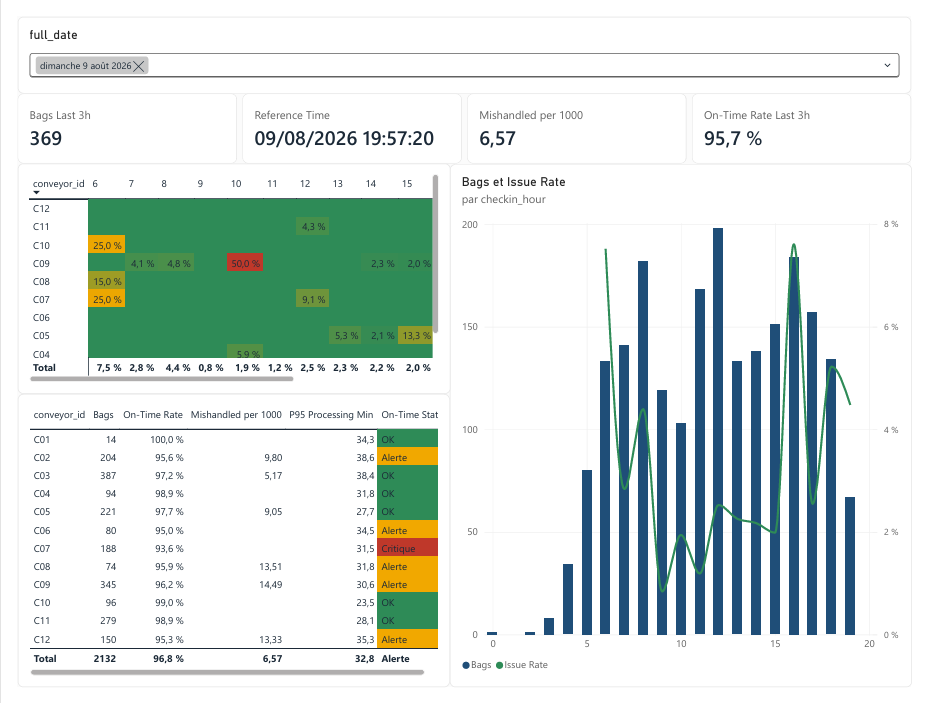
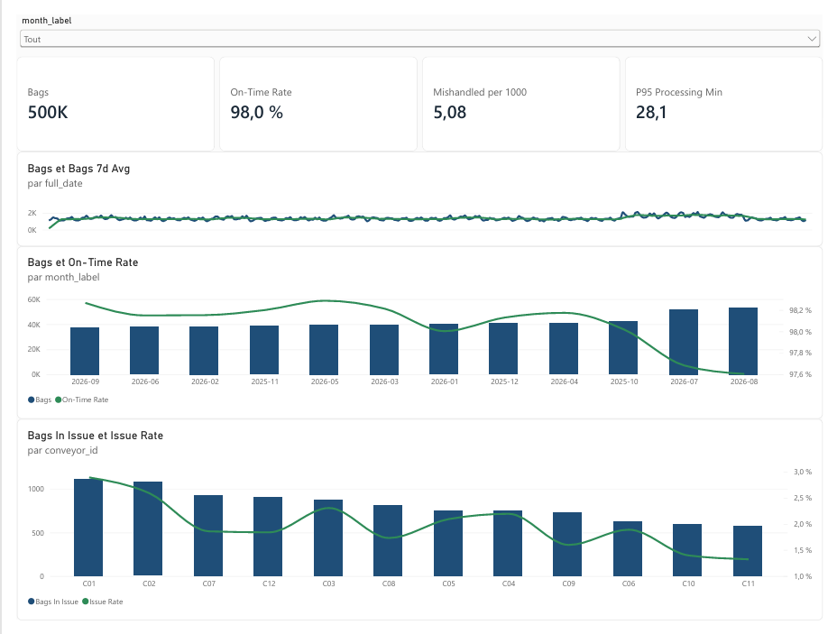

# Tableau de bord KPI bagages (Power BI + SQL + Python)

Simulation d'un centre de tri bagages inspiré de Paris-Orly, avec un dashboard de pilotage en deux vues :
**temps réel** et **post-opérationnel**. Projet personnel ; **toutes les données sont synthétiques**.

## Aperçu

**Vue temps réel** : volume et qualité sur les 3 dernières heures, carte thermique convoyeur x heure, tableau des convoyeurs avec statut d'alerte (jour de pic : 9 août 2026).



**Vue post-opérationnelle** : tendance quotidienne (moyenne glissante 7 jours), comparaison mensuelle, Pareto des convoyeurs.



## Contexte
Ordres de grandeur issus d'une offre publique : 15 km de convoyeurs, ~20 M de bagages/an, pics à ~90 000
bagages/jour. L'échantillon par défaut (500 000 bagages) est à l'échelle ~1/40 ; le rapport pic/moyenne (~1,6)
et les taux de service sont conservés.

## Ce que montre le projet
- Génération d'un jeu de données synthétique réaliste (saisonnalité, pics horaires, pannes, congestion) en Python
- Modèle en étoile en SQL (SQLite) avec vues KPI
- Chargement et typage en Power Query (M), modèle Power BI avec relations et table de dates
- Une trentaine de mesures DAX : taux à l'heure, mal acheminés pour 1 000, P95, moyenne glissante 7 jours, comparaison à S-1, vue « 3 dernières heures », statuts d'alerte
- Mise en forme conditionnelle (carte thermique, statuts) et dictionnaire des KPI avec seuils

## Constats (sur les données simulées)
- **Les convoyeurs C01 et C02 concentrent le plus d'anomalies** : environ 1 100 bagages en retard ou mal acheminés chacun sur l'année, contre environ 600 pour C10 et C11. Leur taux d'anomalie est aussi le plus élevé (environ 2,9 % pour C01 et 2,6 % pour C02), alors que ce sont les convoyeurs les plus longs.
- **L'été dégrade le service** : le volume mensuel passe d'environ 40 000 bagages à plus de 50 000 en juillet et août, et le taux à l'heure descend à environ 97,6-97,7 %, contre environ 98,0 à 98,3 % les autres mois.
- **Le jour de pic (9 août, 2 132 bagages)** : 96,8 % à l'heure, 6,6 mal acheminés pour 1 000, statut global « Alerte ». Cinq convoyeurs sont en alerte (C02, C06, C08, C09, C12) et C07 est en « Critique ». Les volumes culminent vers 8 h, 12 h et 16 h.
- **Précaution de lecture** : les cases les plus rouges de la carte thermique correspondent souvent à des heures à très faible volume, où un seul bagage en anomalie fait monter le taux (par exemple 50 % pour C09 à 10 h). Il faut les lire avec le nombre de bagages.

Leviers possibles (à tester avec des données réelles) : rééquilibrer la charge des convoyeurs longs aux heures de pointe, renforcer la supervision en été, accélérer le traitement des pannes sur C01 et C02.

## Structure du dépôt
```
generate_data.py          génération des données (SQLite + CSV)
sql/schema.sql            schéma en étoile + vues KPI
sql/validation.sql        valeurs de contrôle pour les mesures DAX
powerbi/bagage_kpi.pbix   rapport Power BI
powerbi/power_query.m     chargement et typage des CSV
powerbi/measures.dax      toutes les mesures DAX
powerbi/report_design.md  relations, pages et visuels du rapport
powerbi/theme.json        thème Power BI
docs/KPI_dictionary.md    définition, formule, seuil et utilité de chaque KPI
docs/*.png                captures du rapport
```

## Modèle de données (schéma en étoile)
`fact_baggage` (un bagage : dépôt, chargement, durée, statut), `fact_incident` (pannes), `dim_date`,
`dim_flight`, `dim_conveyor`. Règle métier : un bagage doit être chargé au plus tard 20 min avant le départ du
vol, sinon `late` ; `mishandled` est prioritaire.

## Démarrage
```bash
pip install -r requirements.txt
python generate_data.py --bags 500000 --seed 42
```
Puis ouvrir `powerbi/bagage_kpi.pbix` et modifier le paramètre `DataFolder` (Transformer les données > Gérer les paramètres) pour pointer vers `data/csv/`.
Le guide de construction est dans [`powerbi/report_design.md`](powerbi/report_design.md).

## Valeurs de référence (seed 42, sans filtre)
| Indicateur | Valeur |
|---|---|
| Bagages | 499 777 (7 147 vols, 365 jours du 2025-10-01 au 2026-09-30) |
| Taux à l'heure | 98,05 % |
| Taux de retard | 1,44 % |
| Mal acheminés pour 1 000 | 5,08 |
| Temps de traitement moyen / médian / P95 | 15,86 / 14,64 / 28,11 min |
| Pic horaire | 359 bagages |
| Incidents / indisponibilité | 45 / 3 841 min |
| Pic journalier / moyenne | 2 132 / 1 369 (x1,56) |

## Limites
Données et règles de simulation fictives (seuil de 20 min, pannes aléatoires, congestion selon l'heure, seuils d'alerte arbitraires). Aucun
chiffre ici ne décrit un aéroport réel. La comparaison N-1 nécessite deux ans de données ; la comparaison à S-1 est utilisée à la place.
La vue « temps réel » est simulée à partir de données historiques : l'heure de référence est le dernier dépôt du jour choisi.

## Suite possible
Projet 2 : détection de goulots et prévision des pics en Python, à partir de ces mêmes données.
